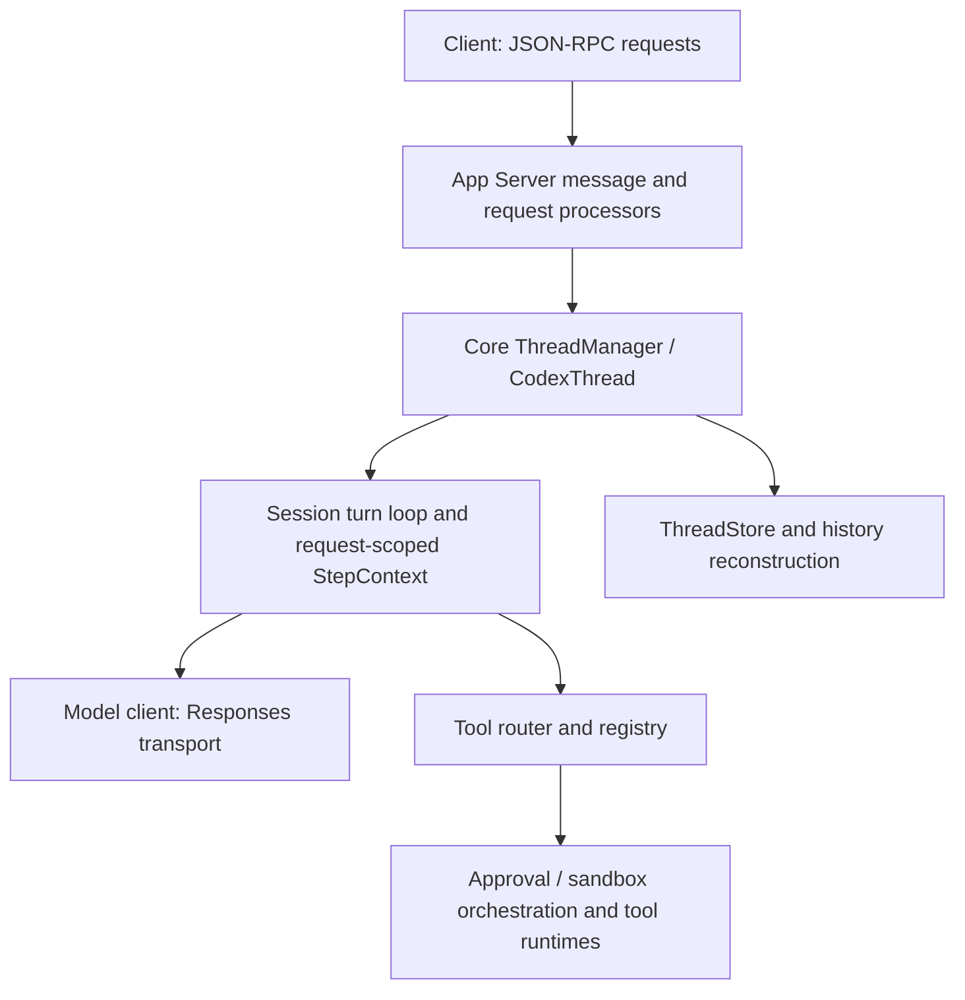

# Codex runtime study before implementing the API engine

Studied on 2026-11-13. This is a source-based architecture study and recommendation, not an
implementation or a complete audit of Codex. No Rust build, tests, live model calls or agents ran.

## Source baseline

The baseline is `openai/codex` tag `rust-v0.164.0`, matching codej's current Codex release.
The annotated tag resolves to commit
[`6aaac694803004a63c6f393d153c96d22521a6b9`](https://github.com/openai/codex/commit/6aaac694803004a63c6f393d153c96d22521a6b9).
All code links below are pinned to that commit. Findings about its provider protocol describe
this release, not every past/future Codex release.

Read selected implementation paths and test scenarios for request dispatch, thread/turn lifetime,
sampling, tool routing, approvals, cancellation, persistence/replay and transport retry. Directory
and Cargo manifests were used to establish module boundaries; this is not a claim that every
implementation or platform sandbox was reviewed.

## App Server and the engine are separate layers

App Server exposes and coordinates the runtime through client requests, notifications and approval
responses. For example, its turn processor resolves settings and calls Core's
`start_or_steer_turn`; Core separately provides `start_turn_if_idle`. The repeated model/tool
execution is in `core/src/session/turn.rs`, not the JSON-RPC dispatcher.

Sources:
[turn request processor](https://github.com/openai/codex/blob/6aaac694803004a63c6f393d153c96d22521a6b9/codex-rs/app-server/src/request_processors/turn_processor.rs#L635-L703),
[Core turn admission](https://github.com/openai/codex/blob/6aaac694803004a63c6f393d153c96d22521a6b9/codex-rs/core/src/codex_thread.rs#L416-L448),
[Core loop](https://github.com/openai/codex/blob/6aaac694803004a63c6f393d153c96d22521a6b9/codex-rs/core/src/session/turn.rs#L159-L180).

Consequently, copying App Server's request handlers alone would not give codej an agent engine.
A runtime port also reaches Core, model transport, history/store, tools, execution and sandboxing.
The dependency manifests show substantial workspace coupling:
[App Server Cargo manifest](https://github.com/openai/codex/blob/6aaac694803004a63c6f393d153c96d22521a6b9/codex-rs/app-server/Cargo.toml),
[Core Cargo manifest](https://github.com/openai/codex/blob/6aaac694803004a63c6f393d153c96d22521a6b9/codex-rs/core/Cargo.toml).

## The two implementation options

| Approach | Reuse | Work and tradeoff | Fit for native provider APIs |
| --- | --- | --- | --- |
| 1a. Retain/fork the Rust runtime behind a process or native bridge | Existing Codex behavior and its runtime implementation | Own the Rust build/platform distribution and bridge or fork maintenance; a native bridge adds a new integration boundary | A native Anthropic/Gemini protocol still needs a different model boundary or translation |
| 1b. Translate the runtime into Java | Selected algorithms and architecture, rewritten for JVM execution | Translate async ownership, storage, policy and platform behavior; reproduce tests and maintain divergence | Still requires separating Responses-shaped assumptions from shared execution |
| 2. Own the Java engine and selectively adopt Codex behavior | Lifecycle invariants, algorithms and test scenarios module by module | Implement a bounded initial feature set; take responsibility for our runtime and provider adapters | Matches the new ModelClient boundary and direct Java SDK integration |

**Selected: option 2 (2026-11-13).** Keep existing Codex/Claude Code connectors using their current
runtimes. Build the direct-API engine as a Java library behind the existing driver/session/turn
contracts. Use Codex as the primary implementation reference and adopt proven behavior in small,
reviewable slices. A copied/translated module should have a specific purpose and compatibility
test, rather than starting from the whole server.

This recommendation is an engineering inference from the inspected dependency and protocol
boundaries, not a measured implementation-time estimate. A complete Rust port was not attempted.
Creating another published Maven artifact is a separate packaging decision; it is unnecessary
for the first engine implementation and would introduce another release surface.

## Findings to carry into codej

### Separate session, turn and model-request lifetimes

Codex distinguishes a session-scoped model client from a turn-scoped client session. The latter
reuses transport state across requests within one turn; its documentation explicitly warns
against reusing the turn's routing token in a later turn. The turn loop captures a request-scoped
`StepContext` so the prompt, advertised tools and tool execution use the same settings view.

For codej, keep transport pools/profile credentials separate from conversation state. Each
conversation has its own durable replay. Each turn owns cancellation and budgets; each model
request captures its model/options/tools/policy view. Never put mutable conversation history in
a globally shared ModelClient or carry a previous turn's transient routing state into a new one.

The current request/replay SPI is sufficient for the initial HTTP adapter. If a concrete later
adapter needs turn-scoped continuation state, add an optional typed context compatibly. Do not
treat the request correlation ID as an idempotency key or store transient transport state in the
durable replay checkpoint.

Sources:
[client lifetime contracts](https://github.com/openai/codex/blob/6aaac694803004a63c6f393d153c96d22521a6b9/codex-rs/core/src/client.rs#L257-L311),
[request settings capture](https://github.com/openai/codex/blob/6aaac694803004a63c6f393d153c96d22521a6b9/codex-rs/core/src/session/turn.rs#L451-L575).

### Keep model protocols outside the shared loop

In this release, `WireApi` has one variant, `Responses`; its deserializer explicitly rejects
the former `chat` setting. Core's model streaming entry matches that protocol and selects
Responses WebSocket/HTTP paths. Provider configuration therefore does not by itself constitute
a native multi-protocol SPI for Anthropic Messages, Gemini or arbitrary API providers.

The shared Java loop must work with ModelRequest/ModelResponse, tool batches and opaque replay.
Each provider adapter owns native serialization, stop reasons, content/signatures, errors and
replay encoding. Do not copy OpenAI ResponseItem types into the generic engine or require a
provider to emulate the Responses API merely to participate.

Sources:
[WireApi](https://github.com/openai/codex/blob/6aaac694803004a63c6f393d153c96d22521a6b9/codex-rs/model-provider-info/src/lib.rs#L106-L135),
[stream transport selection](https://github.com/openai/codex/blob/6aaac694803004a63c6f393d153c96d22521a6b9/codex-rs/core/src/client.rs#L2391-L2445).

### Make durability and writer acquisition explicit

Codex's storage-neutral ThreadStore distinguishes create, resume, append, persist, flush,
shutdown and discard. Resume must return authoritative history including writes committed before
writer acquisition; a caller's earlier snapshot is not sufficient. Appending or enqueueing data
does not necessarily mean it has crossed the documented durability barrier. Shutdown/discard
have different failure-cleanup semantics.

Adopt these guarantees with a small internal session-store abstraction. The first implementation
should use synchronous durable checkpoints at execution boundaries, a writer lease/session lock,
explicit flush/close behavior and cleanup on failed open. Avoid background persistence until its
failure and shutdown guarantees are tested. Keep tool intent/result receipts separate from the
provider replay payload, and write both consistently at the relevant boundaries.

Source:
[ThreadStore contract](https://github.com/openai/codex/blob/6aaac694803004a63c6f393d153c96d22521a6b9/codex-rs/thread-store/src/store.rs#L100-L249).

### Treat replay as authoritative state, not a UI transcript

Core reconstructs history from stored rollout items and compaction checkpoints. Its prompt
projection normalizes paired tool calls/results and filters unsupported content. These are
Responses-specific operations and should not be copied verbatim into a provider-neutral store.

For codej, preserve the adapter's lossless replay payload and a shared execution journal; derive
public events separately. Repair interrupted tool groups using explicit outcomes instead of
pretending an uncertain operation succeeded. Reject unsupported requested content in the initial
engine rather than silently importing Codex's modality-stripping behavior. Compaction needs its
own provider-aware contract and remains deferred.

Sources:
[rollout reconstruction](https://github.com/openai/codex/blob/6aaac694803004a63c6f393d153c96d22521a6b9/codex-rs/core/src/session/rollout_reconstruction.rs#L188-L238),
[history normalization](https://github.com/openai/codex/blob/6aaac694803004a63c6f393d153c96d22521a6b9/codex-rs/core/src/context_manager/history.rs#L964-L982).

### Separate tool routing, policy and actual execution

Codex separates a tool router/registry from execution runtimes. Approval and sandbox decisions
are explicit runtime behavior; a permission prompt alone does not enforce containment. Tool
parallelism is based on registered runtime capabilities and an execution gate, not tool names.

Reuse codej's existing host Tool and approval APIs. Start with text and host tools. Add filesystem
and shell tools only with actual permission/containment enforcement. Keep trusted execution
metadata internal initially rather than changing the public Tool shape. Begin sequentially;
explicit parallel eligibility and resource bounds can follow when needed.

Sources:
[tool routing](https://github.com/openai/codex/blob/6aaac694803004a63c6f393d153c96d22521a6b9/codex-rs/core/src/tools/router.rs#L336-L392),
[runtime contracts](https://github.com/openai/codex/blob/6aaac694803004a63c6f393d153c96d22521a6b9/codex-rs/core/src/tools/sandboxing.rs#L323-L398),
[approval orchestration](https://github.com/openai/codex/blob/6aaac694803004a63c6f393d153c96d22521a6b9/codex-rs/core/src/tools/orchestrator.rs#L125-L205),
[parallel admission](https://github.com/openai/codex/blob/6aaac694803004a63c6f393d153c96d22521a6b9/codex-rs/core/src/tools/parallel.rs#L125-L239).

### Preserve observed completion when cancellation races it

Codex distinguishes response completion, cancellation and outstanding tools. It records observed
response usage and drains in-flight tools. A specific tool-runtime test verifies that cancellation
after the handler finished preserves a completed tool lifecycle. Some handlers must finish their
own cancellation rather than being treated as stopped when a future is cancelled.

Carry these state-machine rules into the Java engine. Cancelling a CompletionStage or interrupting
a thread does not prove that arbitrary Java callback/external work stopped. A successful tool
result already observed must survive cancellation, and a blocked callback must not be reported
as quiescent merely because its consumer stopped waiting.

Sources:
[response completion and usage](https://github.com/openai/codex/blob/6aaac694803004a63c6f393d153c96d22521a6b9/codex-rs/core/src/session/turn.rs#L3177-L3224),
[tool drain and cancellation](https://github.com/openai/codex/blob/6aaac694803004a63c6f393d153c96d22521a6b9/codex-rs/core/src/session/turn.rs#L3404-L3425),
[cancellation race regression](https://github.com/openai/codex/blob/6aaac694803004a63c6f393d153c96d22521a6b9/codex-rs/core/src/tools/parallel.rs#L803-L878).

### Deliberately defer streaming tool execution and transport-specific optimizations

Codex can dispatch a tool when its output item is complete while the overall response is still
streaming, and collects tool results in order. It also has transport fallback, routing tokens,
prewarming, hooks, steering, compaction, subagents and other features. Those are not prerequisites
for the first direct API lane.

Our first engine will wait for a complete ModelResponse and execute the validated batch
sequentially. This trades some overlap/latency for a smaller recovery and cancellation state space.
It is a deliberate difference, not a claim of full Codex behavior. Adopt bounded retry decisions
under one owner; do not copy Responses-specific reconnection/fallback policies into every adapter.

Sources:
[completed-item dispatch](https://github.com/openai/codex/blob/6aaac694803004a63c6f393d153c96d22521a6b9/codex-rs/core/src/session/turn.rs#L2886-L2996),
[ordered result drain](https://github.com/openai/codex/blob/6aaac694803004a63c6f393d153c96d22521a6b9/codex-rs/core/src/session/turn.rs#L2584-L2611),
[Responses retry/fallback](https://github.com/openai/codex/blob/6aaac694803004a63c6f393d153c96d22521a6b9/codex-rs/core/src/responses_retry.rs#L55-L145).

## A useful limit of copying upstream bookkeeping

Codex's ExecutedToolCalls is documented as best-effort evidence with bounded retained state.
It is not a durable exactly-once transaction protocol for arbitrary external tools. We should
not mistake it for the execution receipt store our recovery design needs. A tool action may
happen before a local result is saved; that uncertainty still requires reconciliation.

Source:
[executed-tool evidence](https://github.com/openai/codex/blob/6aaac694803004a63c6f393d153c96d22521a6b9/codex-rs/core/src/tools/executed_tool_calls.rs#L49-L79).

## Adoption plan before engine coding

- [x] Pin the release and trace App Server through Core rather than relying on protocol docs alone.
- [x] Compare a Rust reuse/fork, a Java translation and a Java engine with selective adoption.
- [x] Identify protocol coupling, lifetime, storage, tool admission and cancellation invariants.
- [x] Select option 2 before adding engine production code.
- [x] Define the initial internal session/turn/request state machines and synchronous store guarantees.
- [x] Adapt the selected behavior into focused fake-client/store tests for engine validation.
- [x] Implement the session/store, text loop, host-tool dispatch and execution receipts behind existing interfaces.
- [x] Complete focused verification: 92 selected engine/store/SPI/connector cases passed; results are recorded in the main plan.
- [ ] Implement the Anthropic adapter and public facade.
- [ ] Add a second native provider adapter to exercise provider independence.

Initial test scenarios to adapt from the reviewed behavior:

- Resume uses authoritative history after writer acquisition; failed acquisition/open releases resources.
- A persisted tool result is reused; an execution intent without an outcome is surfaced as uncertain.
- Request settings and advertised tools match the policy used to execute that request's calls.
- Concurrent start is refused; independent conversations do not share replay or cancellation state.
- Cancellation before tool admission invokes no handler; cancellation after success preserves success.
- Stream truncation does not execute partial tools or report successful completion.
- Retry/deadline ownership is bounded and survives notification/backoff delays.
- Shutdown flushes owned state and reports unresolved local work; borrowed services stay open.

Additional upstream test references:
[resume/store scenarios](https://github.com/openai/codex/blob/6aaac694803004a63c6f393d153c96d22521a6b9/codex-rs/core/src/thread_manager_tests.rs#L2366-L2690),
[retry deadline regression](https://github.com/openai/codex/blob/6aaac694803004a63c6f393d153c96d22521a6b9/codex-rs/core/src/responses_retry_tests.rs#L59-L101).
These tests were read, not executed.

## Scope and provenance

This study itself introduced no engine code. The subsequent option-2 implementation adds a Java
engine and fake-client tests as recorded in the main plan, without changing existing production
APIs, dependencies, native artifacts or lanes. Future optional additions must retain committed builders/constructors and existing
API shapes. A new shared engine enables native API providers through adapters; an API key alone
does not establish compatible features or justify silently moving current Codex-backed lanes.

If actual source is copied or translated later, record its pinned origin and modifications and
retain applicable attribution/license notices. The repository has an
[Apache-2.0 LICENSE](https://github.com/openai/codex/blob/6aaac694803004a63c6f393d153c96d22521a6b9/LICENSE)
and a [NOTICE](https://github.com/openai/codex/blob/6aaac694803004a63c6f393d153c96d22521a6b9/NOTICE)
covering included derived work; check the chosen files and dependencies specifically. This note
contains an architectural analysis and source links, not imported runtime code.
