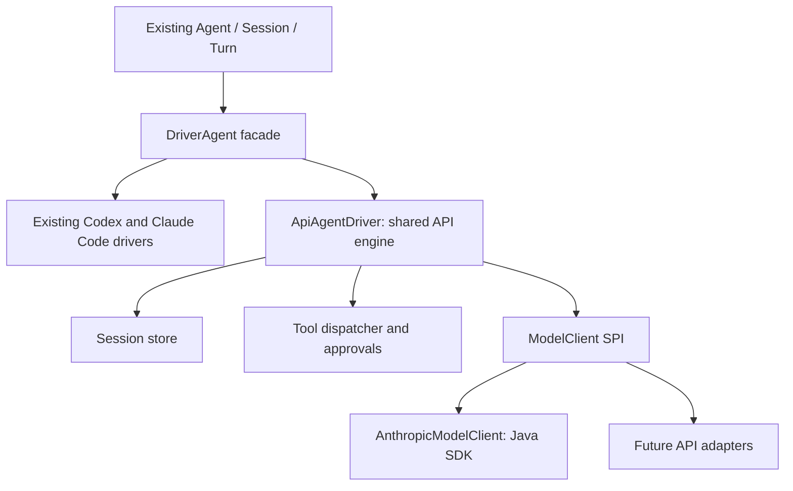

# Direct API connectors

Status: option 2 selected: own the Java engine and selectively adopt Codex runtime behavior.
The model SPI and shared engine are implemented for fake-client validation. A direct Anthropic
adapter and public facade remain follow-up work; no live direct API lane is claimed here.

## Boundaries

Keep the existing `Agent`, `Session`, `Turn`, `AgentConnector`, `ConnectorDriver`, `AgentDriver`,
`AgentSession` and `RunningTurn` contracts. Add a smaller model-client SPI below a shared API
agent engine. Authentication and execution are independent: an API key can authenticate a CLI
runtime, while a direct API adapter performs HTTP inference without that runtime.

| Component | Owns |
| --- | --- |
| Proposed `ClaudeApiConnector implements AgentConnector<ClaudeApiConfig>` | Typed configuration and runtime assembly; no inference at construction |
| `ApiConnector` / `ApiEngineConfig` / `ApiAgentDriver implements ConnectorDriver` | Provider-bound runtime assembly and shared driver/session/turn behavior |
| `ModelClient` | One inference response, model metadata, protocol translation, replay encoding and normalized failures |
| Internal `ApiSessionStore` | Durable checkpoints, execution journal, profile ownership and single-writer locking |
| Internal `ApiToolRegistry` and engine dispatch | Available capabilities, schema validation, approvals, execution, bounded output and execution receipts |

New SPI types live in `shifting-codej-cli`, under
`io.github.shiftinglabs.codej.cli.spi.model`, beside the existing connector SPI. The module name
does not imply a CLI subprocess. Keep the current artifact layout and dependency direction;
separate provider artifacts can be evaluated later. No Anthropic dependency is needed for the SPI.

## Model-client contract

`ModelClient` is thread-safe, owns its transport and serves independent `ModelCall`s. It implements:

- `capabilities(String model)`: side-effect-free model feature information, separate from the
  engine's ability to enforce permissions. Unsupported model IDs are rejected.
- `probe(Optional<String> model)`: readiness without inference or tools; provider metadata I/O
  is allowed. Reuses the existing status DTO; the engine supplies the actual agent capabilities.
- `models()` and `quota()`: optional defaults, respectively empty and unavailable. No inference.
- `generate(ModelRequest, ModelEventSink)`: one complete model response, never host tool execution
  or an entire agent turn. Reject unsupported options, foreign/incompatible replay, null input
  and expired deadlines before submission.
- `close()`: idempotently stop owned calls and close owned transport. Do not close borrowed
  executors/services or delete saved history; report unverified shutdown as failure.

`ModelCall.completion()` settles once with `ModelResponse`, a normalized `ModelClientException`,
or cancellation. Its exceptional completion is internal: the engine maps it into the unchanged
`RunningTurn` terminal result contract. `cancel()` requests cancellation without blocking and is
idempotent. A completed response racing cancellation may win. Local cancellation does not prove
remote computation stopped. All event callbacks finish before completion settles.

`ModelEventSink.textDelta` delivers displayable text serially. Tool dispatch waits for a complete,
validated response; partial JSON arguments never execute. Hidden reasoning, raw SDK objects and
credentials never enter this sink. A sink failure stops streaming and fails the call.

`ModelRequest` uses a builder with explicit request ID, model, new input and positive output-token
bound. Optional fields are instructions, replay state, tool schemas, effort, service tier and an
absolute deadline. Its request ID is correlation, not a provider idempotency guarantee. Instructions
and tool definitions are supplied for every request; they are not reconstructed from UI events.
Immutable classes allow optional future fields without changing existing record shapes or constructors.

`ModelInput.UserMessage` carries text and attachment references. `ModelInput.ToolResults` carries
one complete batch of results for the pending client tool calls, preserving order and IDs. A
result has text and an error flag; it remains tool content, never system instructions. The adapter
checks batch completeness against its replay state. Attachments must be durably staged by the
engine/store; the SPI constructors do no file I/O.

`ModelResponse` contains full displayable text, a complete executable client-tool batch, replay
state and optional final usage for this inference request. The stop reason distinguishes
`COMPLETED`, `TOOL_CALLS`, `OUTPUT_LIMIT`, `REFUSED` and `PAUSED`. Only the first is successful
agent completion. Unexpected stream termination fails the call; it is not an output-limit response.
Server tools are never represented as executable client tool calls. Unknown or unsupported
protocol content must not be silently dropped.

Tool schemas and argument envelopes must be single JSON objects. The SPI performs structural
validation; the engine additionally evaluates its supported JSON Schema subset before invoking
a handler: type, properties, required, additionalProperties, items and enum, with description/title
annotations. This covers the schemas generated by `Tool.of`. Unsupported assertions or malformed
schemas fail before session creation; they are never silently ignored.
Duplicate tool names/call IDs/result IDs are rejected. Collections are defensively copied.

Failure kinds distinguish authentication, rate limits, temporary unavailability, invalid requests
and protocol failures. `deliveryUncertain` records whether acceptance is unknown. Diagnostic
messages are sanitized; no raw SDK exception escapes. Authentication maps to the existing
`AUTHENTICATION_REQUIRED` failure kind; other failures use existing terminal fields and transient
failure semantics. No values are added to existing enums.

## Sessions and replay

The engine's `open()` creates or loads a local conversation without inference. `start()`
persists new input, then runs the model-tool loop. Resume loads saved state rather than invoking
Claude Code or a CLI resume command. The initial Anthropic adapter targets the Messages API.

Persist a versioned manifest with the connector/profile identity, stable conversation ID,
attachment references, checkpoints, turn IDs and execution receipts. Hold a session lock for
one writer across processes and permit only one active turn. Set `resumable()` only after a durable
recoverable checkpoint exists. Closing preserves history. Resume checks ownership/version and
applies current permission settings and callbacks; previous approvals are not permanent grants.

`ModelReplayState(providerId, formatVersion, payload)` is adapter-owned, lossless replay data.
It may contain original content blocks, signatures or provider continuation handles. The engine
stores it privately without interpreting, rewriting or redacting it. Its `toString()` hides the
payload. Provider identity alone does not establish profile ownership; the manifest enforces that.
Transport credentials never belong in this state. Credential rotation preserves session identity.
Moving history to another provider requires an explicit future migration operation.

Visible events are not the authoritative transcript. For Claude, tool workflows can require
the previous assistant content, including thinking blocks and signatures, unchanged. Checkpoint
formats are independently versioned from the existing public session-reference contract.

Context-window limits must produce an explicit outcome initially. Later compaction must preserve
complete tool-call/result groups and required provider blocks; never silently truncate history.

## Tool loop, permissions and recovery

For one public turn:

1. Durably append user input and request a response with the remaining deadline/token budget.
2. Stream safe normalized events. On a complete response, save replay state and pending tool calls.
3. Resolve tools from the session's capabilities, validate arguments and obtain required approvals.
4. Persist each execution intent, execute, then persist its bounded result before the next request.
5. Return the complete tool-result batch to the model and repeat until a terminal outcome.

Reuse existing `Tool` objects and approval callbacks. Model adapters receive schema-only
definitions, never Java handlers. A transport-independent dispatcher can share suitable existing
broker logic without changing its MCP API or CLI behavior. No local MCP server is required to
invoke a Java handler. Begin with sequential calls and bounded total requests, calls, output,
deadline and callback queues; add bounded parallelism only with an explicit independence policy.

`TEXT_ONLY` exposes no tools; `TOOLS_ONLY` exposes host-supplied capabilities. Host callbacks are
trusted capabilities, not automatically sandboxed by this library. A name/schema does not prove
read-only behavior. Full filesystem/shell/network/review support needs tools with real enforcement.
Reject unsupported constraints in `validate()` rather than replacing them with prompt instructions.
The first engine delivery supports text and host tools; native coding-tool parity is a later step.

Never replay a completed tool when retrying inference. A saved result is reused; an execution
intent with no saved outcome is uncertain and requires reconciliation. Do not promise exactly-once
effects for arbitrary external systems. Recovery must resolve pending tool-result groups before
new user input is submitted, retaining explicit interrupted/unknown outcomes rather than silently
rerunning side effects. A partial response never authorizes tools.

Use one retry owner. Configure SDK retry behavior explicitly; do not multiply SDK and engine
retries or automatically retry after visible output/uncertain delivery. Cancellation stops further
requests, closes the stream and requests cancellation of local tools. Uncooperative handlers can
prevent quiescence and must be reported. Use bounded shared resources, not a worker per token.

Usage is final per model request; the engine aggregates distinct requests once per public turn.
Unknown cost stays absent. Account quota is not inferred from token usage or subscription probes.

## Backward compatibility

Keep existing public signatures, generic factory types, constructors, record components, enums,
sealed hierarchies, constants, lane IDs, reference encodings, default paths and CLI behavior.
Do not change `ClaudeSettings` or `ClaudeConnector`'s configuration type. Add a separate proposed
`ClaudeApi` builder returning the existing `Agent` interface. Give API sessions a distinct new
provider/lane identity so Claude Code references cannot be mistaken for direct API conversations.
Do not rename/move existing packages or change the shaded artifact and release conventions.

This first SPI step adds production types only; no existing production Java file or dependency is
modified. Full artifact compatibility and affected Bytequay validation remain gates for the later
integrated runtime, not claims made by these focused contract tests.

## Checkbox implementation plan

The [pinned Codex runtime study](codex-runtime-study.md) compares a runtime port with selective
adoption into a Java engine. It recommends the latter and records the source-derived invariants
and deliberate initial differences. Option 2 was selected on 2026-11-13; no Rust runtime code is
copied, bundled or translated into the engine in this step.

### Step 1: SPI and baseline contracts (current scope)

- [x] Record the architecture, ownership, replay, tool loop and compatibility boundaries here.
- [x] Add model-client/call/event-sink interfaces without changing existing SPI types.
- [x] Add immutable request, response, capabilities, replay and normalized failure types.
- [x] Add reusable `AbstractTestModelClient` contracts and a scripted in-memory binding.
- [x] Add a consumer example showing schema-only inference and host tool-result continuation.
- [x] Cover every new method, defaults, validation, ownership and immutable value boundaries.
- [x] Run only selected fake-provider/value/legacy consumer suites with one constrained test JVM.
- [x] Verify the source diff is additive for existing production APIs and record exact results.

Validation on 2026-11-13: the focused command in [CONTRIBUTING.md](../../CONTRIBUTING.md#direct-model-spi-contracts)
passed `verify`, Checkstyle and license checks. `TestModelSpiValues` passed 17 cases,
`TestModelClientSpi` passed 11 (including eight inherited model-client contracts), and the existing
`TestConnectorSpi` consumer passed five: 33 total, zero failures/errors/skips. Maven ran serially
with one test fork, JUnit parallel execution disabled, one active CPU, a 512 MB heap and Serial GC.
The sandbox blocked the initial `nice` setting; the active focused Maven process was subsequently
lowered to priority 10 before the test fork started.

All 145 previously tracked production files across the three modules match `HEAD` byte for byte;
production changes are additions in the new model SPI package only. POMs, dependencies and existing
test sources are unchanged. No agents, native CLI tests, process-stress tests, live provider calls,
SDK-wide tests or Bytequay tests were started. These results establish the SPI baseline, not a
working direct Claude API lane or a full published-artifact compatibility result.

### Step 2: Shared engine

- [x] Study the pinned Codex App Server/Core source, including persistence, tool dispatch and cancellation.
- [x] Select option 2 and define internal session/turn/request ownership and synchronous checkpoint guarantees.
- [x] Implement `ApiAgentDriver` over existing driver/session/turn contracts with a fake client first.
- [x] Add the durable store, profile manifest, staged attachments, atomic checkpoints and session lock.
- [x] Implement tool dispatch, approvals, execution receipts and interrupted/uncertain recovery.
- [x] Enforce request/tool/observed-token budgets, cancellation, usage aggregation, output bounds and resource ownership.
- [x] Add `AbstractTestApiConnector` extending the existing connector contracts; cover resume,
  crashes, permissions, tool failures and external consumer usage without native processes.
- [x] Pass focused engine/store/SPI/connector contracts and record exact verification scope before commit.

Validation on 2026-11-13: the explicitly selected command in
[CONTRIBUTING.md](../../CONTRIBUTING.md#shared-api-engine-contracts) passed `verify`, Checkstyle
and license checks in a temporary snapshot based on `c911863` containing only this change.
The selected suites passed 92 cases, zero failures/errors/skips:

| Suite | Cases |
| --- | ---: |
| TestApiAgentDriver | 23 |
| TestApiSessionStore | 5 |
| TestApiConnector (including inherited contracts) | 6 |
| TestModelSpiValues | 17 |
| TestModelClientSpi | 11 |
| TestConnectorSpi (existing legacy consumer) | 5 |
| TestCodexConnector | 15 |
| TestClaudeConnector | 10 |

Maven ran serially, with one test fork at a time, JUnit parallel execution disabled, one active
CPU, a 512 MB heap, Serial GC and nice priority 10. The fake clients perform no inference and
the borrowed supervisor fixtures reject any process operation. The final tested Java hashes
match the implementation. No pre-existing production Java file, dependency, version or public
SPI shape is changed by this engine step. The only existing Java edit is a test-base hook whose
default preserves the CLI validation context. Four unrelated Claude working-tree edits were
excluded from the snapshot and commit and left unchanged. No agents, native CLI/process-stress,
live-provider, broad SDK, published-artifact ABI or Bytequay tests were run.

The engine checkpoints under the supplied profile's `api-sessions/<opaque UUID>/checkpoint.json`.
Its manifest binds connector, profile, lane and store version. A file lock is held until the
session's local work is confirmed stopped. Private file permissions, forced writes and atomic
replacement provide the synchronous checkpoint boundary. The initial store targets the project's
existing POSIX platform scope; no cross-platform native packaging is added.

`ApiEngineConfig` owns a fresh ModelClient from its supplier. Default turn workers are bounded by
session capacity; a supplied ExecutorService is borrowed and remains open. Host tool handlers run
on the turn worker. A positive turn runtime installs an owned cancellation timer; a zero runtime
retains the existing no-deadline meaning. Model call completion, rather than future cancellation
alone, is the transport quiescence fence. Close is bounded and reports failure while retaining
the session writer if a model call or callback has not stopped. Close from an active callback
requests stopping but reports that synchronous shutdown cannot be confirmed; the host can retry.

There are no automatic inference retries in this first engine. Explicitly uncertain request
delivery or a started tool without a durable result blocks subsequent submission and reports
that reconciliation is required. There is no force-replay API. Completed tool results survive
cancellation; interrupted unstarted calls become explicit error results. On resume, the engine
finishes that pending batch with its saved model/options/tools before sending fresh user input.
The original tool definitions must match; approvals and execution use the current host callbacks.
Previously granted approvals are not restored. A failed checkpoint write damages the live session
and prevents further submission instead of acknowledging uncommitted history.

Observed input/output token usage is counted once per model response and emitted as delta usage
through existing events. It is an observed budget, not a pre-submission guarantee about provider
input tokens or billing. Output tokens, request count, tool count, text, attachments, tool output
and checkpoint size have separate bounds. The checkpoint-size limit stops growth explicitly;
compaction and retention remain separate follow-ups. No hidden replay data is sent through events.

### Step 3: Direct Claude API

- [ ] Implement `AnthropicModelClient` with the official Java SDK behind the new model SPI.
- [ ] Validate models/options; preserve complete replay blocks; format tool results and normalize usage/errors.
- [ ] Configure explicit credentials, endpoint, retry policy, bounded transport resources and redaction.
- [ ] Bind the reusable model contracts through a controlled fake HTTP transport; test Claude wire details.
- [ ] Add `ClaudeApiConfig`, `ClaudeApiConnector` and the additive `ClaudeApi` facade.
- [ ] Add a public usage example returning the existing `Agent`/`Session`/`Turn` types.

### Step 4: Integration and follow-ups

- [ ] Run the existing published-artifact compatibility check on the integrated shaded artifact.
- [ ] Run affected Bytequay tests using the unchanged downstream API/dependency conventions.
- [ ] Add another direct API provider through the same contracts to validate engine reuse.
- [ ] Add shared filesystem/shell tools only with verified containment and permission tests.
- [ ] Evaluate optional compaction, provider-hosted tools and separate connector artifacts as needed.

## Sources

Checked 2026-11-13:

- [Anthropic Java SDK](https://platform.claude.com/docs/en/cli-sdks-libraries/sdks/java): direct API,
  streaming, configuration and built-in retries.
- [Claude Messages API](https://platform.claude.com/docs/en/api/http/messages/create): conversation
  input and stateless multi-turn requests.
- [Handle tool calls](https://platform.claude.com/docs/en/agents-and-tools/tool-use/handle-tool-calls):
  client-tool results, IDs, ordering and errors.
- [Thinking in tool workflows](https://platform.claude.com/docs/en/build-with-claude/thinking-tool-workflows):
  lossless assistant replay requirements.
- [Agent SDK comparison](https://code.claude.com/docs/en/agent-sdk/overview): direct API client
  versus Claude Code's agent harness.
