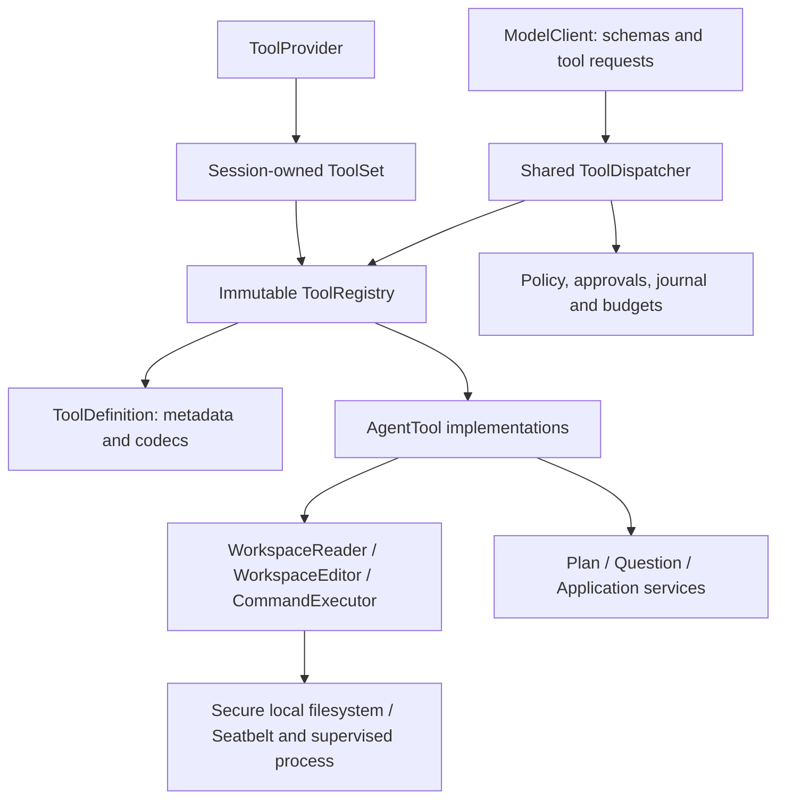

# Extensible tool framework proposal

Status: proposed for review. This document does not introduce production interfaces or change
current tool behavior. It builds on [coding-tools.md](coding-tools.md) and the existing connector
SPI. Frequent tool additions, implementation replacements, typed parameters, and backward
compatibility are primary requirements.

## Decisions

- One tool SPI serves coding, planning, user interaction, application tools, and future integrations.
- Separate the tool's contract from its implementation, parameter binding, and resource backend.
- No `Class<?>` tokens or `extends Record` restriction in the new SPI. Parameter and result
  behavior is supplied through interfaces. Validated records remain the preferred data values.
- Reflection is an optional codec implementation, hidden behind those interfaces.
- Keep `Tool`, every existing `Tool.of`/`withSchema` overload, connector SPI, public record shape,
  tool name, and existing default behavior compatible.
- Tool families organize installation and lifecycle. They do not grant permissions.
- The common dispatcher owns validation, policy, approvals, receipts, budgets, events, and recovery.
- Implementations receive narrow resource services. Those services enforce containment at use.
- Initial tool registration is explicit and immutable per session. Dynamic plugin loading and
  replacement during an active turn are outside the first implementation.

## Framework



A model provider does not select tool implementations. Claude API and DeepSeek API consume the
same advertised tool definitions; the engine resolves the request to the session's bound tool.
CLI runtimes retain their existing native tools. A later CLI/MCP export adapter may expose our
registered host tools, without replacing the CLI's own execution loop.

## Core interfaces

These are proposed signatures. Supporting values such as ToolSchema, ToolArguments, ToolOutput,
ToolDescriptor, ToolRequirements, and contexts are not implemented by this document.

```java
public interface ToolParameters<P>
{
    ToolSchema schema();
    P decode(ToolArguments arguments);
}

public interface ToolResultCodec<R>
{
    ToolOutput encode(R result);
}

public interface ToolDefinition<P, R>
{
    ToolDescriptor descriptor();
    ToolParameters<P> parameters();
    ToolResultCodec<R> results();
}

public interface AgentTool<P, R>
{
    ToolDefinition<P, R> definition();
    ToolRequirements requirements(P parameters, ToolPreparationContext context);
    ToolExecution<R> execute(P parameters, ToolExecutionContext context);
}

public interface ToolExecution<R>
{
    CompletionStage<ToolOutcome<R>> completion();
    void cancel();
    CompletionStage<ToolStopResult> stopAndVerify();
}

public interface ToolProvider<C>
{
    String id();
    List<ToolDefinition<?, ?>> definitions(C configuration);
    ToolSet open(C configuration, ToolSetContext context);
}

public interface ToolSet extends AutoCloseable
{
    List<AgentTool<?, ?>> tools();
    void close();
}
```

`ToolDefinition` describes a stable logical operation. Its parameter/result codecs are the source
of truth for binding and rendering. A standard immutable definition implementation can use a
builder; other implementations can construct definitions from an external schema. Definitions
are side-effect-free and contain no null handlers or unopened resource placeholders.

`AgentTool` implements that operation. Its requirements method performs no effects; it derives
request-specific access needs from already validated parameters and read-only preparation services.
Execution receives the same immutable parameter snapshot. The dispatcher binds the selected
implementation, requirements, and captured policy together before approval. Backends recheck
filesystem identities and granted access at use; a preflight path check alone is insufficient.

`ToolExecution` separates the logical outcome from proof that work stopped. Cancellation only
requests a stop. `stopAndVerify()` is bounded and retryable, and cannot report stopped while a
callback, command, descendant, or external operation is still active. Uncertain outcomes are
explicit; cancellation does not erase an observed successful outcome. Synchronous tools use a
shared completed-execution helper instead of implementing their own lifecycle machinery.

`ToolProvider` installs a coherent family and creates session-scoped resources. Its definitions
method performs no filesystem/process/model work. `open` may acquire workspace leases and check
configured backends, but performs no model-requested action or inference. An explicitly required
backend that cannot enforce policy fails closed. Independently configured optional tool sets may
be absent with diagnostics; they never fall back to an unsandboxed implementation.

`ToolSet` owns resources it creates and borrows host services. Shared workspace resources have one
owner even when multiple handlers use them. Closing must confirm quiescence before releasing
writer claims; borrowed process supervisors and executors are not closed.

## Parameters and results without Class tokens

Example contracts and implementations:

| Boundary | Interface | Possible implementations |
| --- | --- | --- |
| Parameter binding | `ToolParameters<ReadFileRequest>` | Explicit record codec, generated codec, cached reflection adapter |
| Result rendering | `ToolResultCodec<FileContent>` | Structured JSON encoder, model-facing text encoder |
| Logical operation | `AgentTool<ReadFileRequest, FileContent>` | ReadFileTool using an injected WorkspaceReader |
| Filesystem reads | `WorkspaceReader` | Existing secure local implementation; later an explicitly selected remote implementation |
| Commands | `CommandExecutor` | Existing Seatbelt backend; later Linux/container backends with their own containment contracts |

A parameter codec advertises a schema and decodes transport arguments into validated immutable
values. Missing/unknown fields, wrong types, malformed input, invalid ranges, unsupported schema
assertions, and invalid cross-field combinations fail before tool execution. The typed SPI binds
once before approval. Record constructors defensively copy collections and check invariants.

The SPI does not require a runtime Java class to discover a schema or bind parameters. A
reflection-backed adapter may internally use a Class token to preserve existing convenience APIs.
A hand-written or generated codec needs no reflection. Different codecs for the same logical
contract must agree on the accepted schema and canonical values; parameter-contract tests enforce
that agreement. JSON trees stay inside codecs/schema processing, not domain handlers.

Use an interface for a parameter value itself only when it has real interchangeable representations;
a validated record can implement that interface. An interface for every record field or a marker
CodingTool hierarchy would not add behavior. Paths, bounds, actions, and file contents remain typed
values. The generic SPI permits both value interfaces and concrete records.

`ToolArguments` encapsulates bounded transport input. Initially this is the existing JSON argument
format. `ToolSchema` represents the supported validated schema; unsupported assertions fail closed.
`ToolOutput` is bounded, typed model-facing content. Initially it projects into the existing text
`ModelInput.ToolResult`; image/media results require a separate compatible extension rather than
changing that record or the sealed ModelInput hierarchy.

## Coding tools and resource interfaces

Each logical tool becomes a small implementation of AgentTool. Shared enforcement remains in
resource services rather than being copied into every handler.

| Tool implementation | Injected service | Main service operations |
| --- | --- | --- |
| ReadFileTool | WorkspaceReader | read |
| ListFilesTool | WorkspaceReader | list |
| SearchFilesTool | WorkspaceReader | search |
| ApplyPatchTool | WorkspaceEditor | apply |
| ShellCommandTool | CommandExecutor | start, returning a controlled execution handle |
| Future UpdatePlanTool | Plan service | validate and persist plan update |
| Future RequestUserInputTool | Question service | request and await a bounded response |

WorkspaceReader, WorkspaceEditor, and CommandExecutor are independent interfaces, not marker
subinterfaces of AgentTool. Their requests/results are provider-neutral validated values. Command
execution delegates to the existing ProcessSupervisor for durable launch lifecycle; sandbox
selection and enforcement belong in the CommandExecutor implementation. A process supervisor by
itself is not a containment backend.

The current filesystem implementation can initially implement both reader and editor interfaces.
A read-only tool is injected only with reader authority. ToolExecutionContext supplies invocation
identity, cancellation/deadline, event reporting, and narrowly scoped durable execution hooks;
it does not expose a global service locator, raw process launcher, model client, or unrestricted
filesystem handle. ToolSetContext is the trusted assembly boundary for providers.

Tool requirements are access descriptions, not grants. The dispatcher derives effective authority
from host policy and approval, and the backend enforces it. Built-ins keep mandatory approval and
current containment. Arbitrary in-process Java plugins remain trusted host code, as existing Tool
callbacks are; the new interfaces do not sandbox arbitrary Java instructions.

## Dispatch and persistence

1. Resolve a tool from the session's immutable registry snapshot.
2. Decode and validate parameters through its ToolParameters implementation.
3. Derive requirements for that exact immutable request and verify host policy.
4. Obtain any required approval; approval cannot widen the configured boundary.
5. Persist intent, tool contract identity, and relevant execution ownership before effects.
6. Execute through the bound implementation and its scoped resource services.
7. Encode, bound, and redact the outcome, then persist it before subsequent inference.
8. Acknowledge external launch resources only after the outcome is durable. Retain ownership and
   block unsafe continuation when effects or termination are uncertain.

No dispatcher branches on concrete tool classes, provider names, or tool-name strings. Resource
budget and execution policy follow the registered contract and host policy. Built-in versus
legacy behavior is bound during registration, replacing today's BuiltinTools.contains checks in
the engine. Families are labels and installation boundaries, never authorization shortcuts.

## Adding or updating tools frequently

- Add a definition/codec, one handler, and a provider registration. The dispatcher and model
  adapters remain unchanged. A second implementation is selected by assembly/configuration;
  two implementations cannot silently claim the same logical tool in one registry.
- Cache schema compilation and codec setup at registration. Use existing bounded workers and
  per-invocation handles; avoid per-token work, per-file JVMs, or worktree copies.
- A tool keeps its name and contract when only its implementation changes. Definition/schema
  changes have an explicit contract version and canonical fingerprint, independent of an
  implementation diagnostic revision. Do not pretend a schema hash detects behavioral changes.
- Persist the selected contract/version for pending calls. Completed results are reused. A started
  call with an unknown outcome never reruns because a new implementation has been deployed.
- Resume validates pending contracts. A compatible implementation replacement must still meet
  those contracts; incompatible changes require an explicit adapter/migration or are rejected.
- Existing sessions hold their chosen implementations for their lifetime in the first version.
  Updates take effect for new sessions; resumed sessions apply the current host policy and the
  documented compatibility checks. Mid-turn hot replacement is deferred.
- Every implementation runs the same behavioral base tests for its contract. Platform backends
  additionally run their containment/lifecycle tests. A schema-compatible change can still violate
  semantics, so round-trip codec tests alone are insufficient.

## Compatibility and module placement

- Keep the existing final Tool class and all its signatures. LegacyToolAdapter wraps existing
  Tool objects without changing their supplied schema, callback execution, or approval defaults.
  Opaque legacy callbacks retain their original binding behavior inside Tool.call.
- Add an interface-based Tool.of overload only if needed for upstream custom tools. The existing
  Class-based overload delegates through the reflection adapter and remains available unchanged.
- Keep old ToolMessages records and CodingTools constructors/components intact. New logical
  contracts can adapt their values; do not add mandatory record components or remove old types.
- Keep current built-in names, descriptions, schemas, defaults, and approval/sandbox behavior in
  the initial migration. Richer tool contracts are follow-up additions, not hidden refactor changes.
- Preserve public BuiltinTools entry points as delegating compatibility facades. WorkspaceFiles
  and SandboxCommand are internal implementations that can be adapted behind the new services.
- Parameter/schema/result contracts needed by public Tool factories belong in shifting-codej-api.
  Runtime SPI belongs beside the model SPI in shifting-codej-cli, with implementations under the
  shared engine packages. Avoid dependency inversion from the API module into the CLI module.
- Do not change existing AgentConnector.configurationType or any other connector contract merely
  to remove a Class token. The new tool SPI does not copy that requirement. ToolProvider's generic
  configuration is bound explicitly by the caller; it does not infer types through reflection.
- Keep artifact layout, CLI-native behavior, reference encodings, and ModelClient contracts intact.
- Evolve optional SPI features through conservative default methods and optional builder settings.
  Adding a tool should not require adding an abstract SPI method, modifying released record
  components, or extending an existing sealed hierarchy. Unsupported capabilities fail closed.

## Contract tests and staged plan

Proposed base suites:

- AbstractTestToolParameters: schema/binding agreement, invalid input, immutable values, alternative codecs.
- AbstractTestAgentTool: requirements before effects, result contract, failures, cancellation, uncertainty.
- AbstractTestWorkspaceReader / Editor: shared filesystem semantics plus containment and stale preimages.
- AbstractTestCommandExecutor: output/runtime bounds, durable launch order, stop verification and cleanup.
- AbstractTestToolProvider: pure definitions, duplicate names, resource ownership and failed-open cleanup.
- Dispatcher tests: approval denial, policy capture, durable receipts, no replay and compatibility adapters.

The following work is proposed, not implemented by this document:

- [x] Record the interface boundaries and Class-free parameter/result contracts for review.
- [ ] Add the SPI, immutable supporting values, fake implementations, and baseline contract tests.
- [ ] Add legacy Tool and reflection codec adapters; prove existing public APIs and behavior unchanged.
- [ ] Extract ToolDispatcher from ApiAgentDriver; route current tools through registered definitions.
- [ ] Split the current five registrations into handlers backed by the resource interfaces.
- [ ] Bind existing secure filesystem and Seatbelt implementations; retain all current limits.
- [ ] Run only focused contracts, existing affected tool/facade tests, and artifact compatibility checks.
- [ ] Add a new tool and an alternate fake backend as extension examples without editing the dispatcher.
- [ ] Consider richer execution, directory/move tools, plans/questions, and optional integrations separately.

This proposal step introduces no production refactor or dependency changes. Implementation and
focused verification follow as separate stages; no agents are used.
