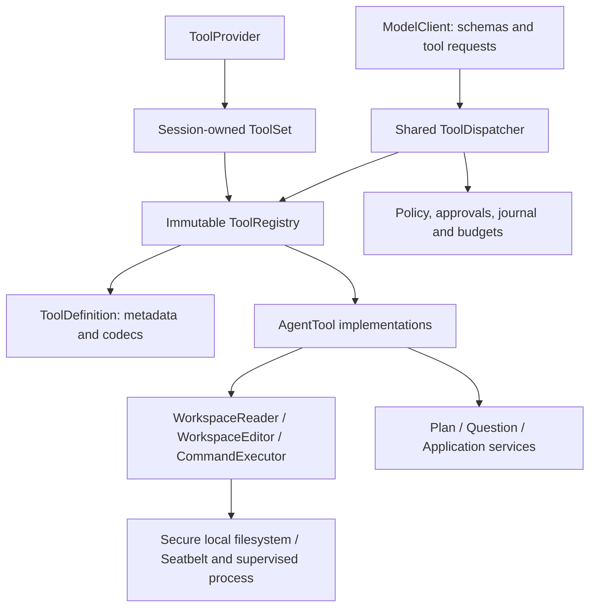

# Extensible tool framework proposal

Status: the SPI, legacy adapters, shared dispatcher, built-in handlers and resource interfaces are implemented.
Existing public APIs and tool behavior are retained; configured provider assembly remains planned. It builds on [coding-tools.md](coding-tools.md) and the existing connector
SPI. Frequent tool additions, implementation replacements, typed parameters, and backward
compatibility are primary requirements.

## Decisions

- One tool SPI serves coding, planning, user interaction, application tools, and future integrations.
- Separate the tool's contract from its implementation, parameter binding, and resource backend.
- No `Class<?>` tokens or `extends Record` restriction in the new SPI. Parameter and result
  behavior is supplied through interfaces. Validated records remain the preferred data values.
- Reflection is an optional codec implementation, hidden behind those interfaces.
- Keep `Tool`, every existing `Tool.of`/`withSchema` overload, connector SPI, public record shape,
  tool name, and existing default behavior compatible.
- Tool families organize installation and lifecycle. They do not grant permissions.
- The common dispatcher owns validation, policy, approvals, receipts, budgets, events, and recovery.
- Implementations receive narrow resource services. Those services enforce containment at use.
- Initial tool registration is explicit and immutable per session. Dynamic plugin loading and
  replacement during an active turn are outside the first implementation.

## Framework



A model provider does not select tool implementations. Claude API and DeepSeek API consume the
same advertised tool definitions; the engine resolves the request to the session's bound tool.
CLI runtimes retain their existing native tools. A later CLI/MCP export adapter may expose our
registered host tools, without replacing the CLI's own execution loop.

## Core interfaces

These interfaces are implemented. Parameter/schema/result contracts live in
`shifting-codej-api` under `io.github.shiftinglabs.codej.tool`; runtime contracts live in
`shifting-codej-cli` under `io.github.shiftinglabs.codej.cli.spi.tool`.

```java
public interface ToolParameters<P>
{
    ToolSchema schema();
    P decode(ToolArguments arguments);
}

public interface ToolResultCodec<R>
{
    ToolOutput encode(R result);
}

public interface ToolDefinition<P, R>
{
    ToolDescriptor descriptor();
    ToolParameters<P> parameters();
    ToolResultCodec<R> results();
}

public interface AgentTool<P, R>
{
    ToolDefinition<P, R> definition();
    ToolRequirements requirements(P parameters, ToolPreparationContext context);
    ToolExecution<R> execute(P parameters, ToolExecutionContext context);
}

public interface ToolExecution<R>
{
    CompletionStage<ToolOutcome<R>> completion();
    void cancel();
    CompletionStage<ToolStopResult> stopAndVerify();
    default void committed() {}
}

public interface ToolProvider<C>
{
    String id();
    List<ToolDefinition<?, ?>> definitions(C configuration);
    ToolSet open(C configuration, ToolSetContext context);
}

public interface ToolSet extends AutoCloseable
{
    List<AgentTool<?, ?>> tools();
    void close();
}
```

`ToolDefinition` describes a stable logical operation. Its parameter/result codecs are the source
of truth for binding and rendering. A standard immutable definition implementation can use a
builder; other implementations can construct definitions from an external schema. Definitions
are side-effect-free and contain no null handlers or unopened resource placeholders.

`AgentTool` implements that operation. Its requirements method performs no effects; it derives
request-specific access needs from already validated parameters and read-only preparation services.
Execution receives the same immutable parameter snapshot. The dispatcher binds the selected
implementation, requirements, and captured policy together before approval. Backends recheck
filesystem identities and granted access at use; a preflight path check alone is insufficient.

`ToolExecution` separates the logical outcome from proof that work stopped. Cancellation only
requests a stop. `stopAndVerify()` is bounded and retryable, and cannot report stopped while a
callback, command, descendant, or external operation is still active. Uncertain outcomes are
explicit; cancellation does not erase an observed successful outcome. Synchronous tools use a
shared completed-execution helper instead of implementing their own lifecycle machinery.
The optional `committed()` hook acknowledges execution resources only after a durable result;
failed acknowledgement remains retryable and is never used for an unpersisted result.

`ToolProvider` installs a coherent family and creates session-scoped resources. Its definitions
method performs no filesystem/process/model work. `open` may acquire workspace leases and check
configured backends, but performs no model-requested action or inference. An explicitly required
backend that cannot enforce policy fails closed. Independently configured optional tool sets may
be absent with diagnostics; they never fall back to an unsandboxed implementation.

`ToolSet` owns resources it creates and borrows host services. Shared workspace resources have one
owner even when multiple handlers use them. Closing must confirm quiescence before releasing
writer claims; borrowed process supervisors and executors are not closed.

## Parameters and results without Class tokens

Example contracts and implementations:

| Boundary | Interface | Possible implementations |
| --- | --- | --- |
| Parameter binding | `ToolParameters<ReadFileRequest>` | Explicit record codec, generated codec, cached reflection adapter |
| Result rendering | `ToolResultCodec<FileContent>` | Structured JSON encoder, model-facing text encoder |
| Logical operation | `AgentTool<ReadFileRequest, FileContent>` | ReadFileTool using an injected WorkspaceReader |
| Filesystem reads | `WorkspaceReader` | Existing secure local implementation; later an explicitly selected remote implementation |
| Commands | `CommandExecutor` | Existing Seatbelt backend; later Linux/container backends with their own containment contracts |

A parameter codec advertises a schema and decodes transport arguments into validated immutable
values. Missing/unknown fields, wrong types, malformed input, invalid ranges, unsupported schema
assertions, and invalid cross-field combinations fail before tool execution. The typed SPI binds
once before approval. Record constructors defensively copy collections and check invariants.

The SPI does not require a runtime Java class to discover a schema or bind parameters. A
reflection-backed adapter may internally use a Class token to preserve existing convenience APIs.
A hand-written or generated codec needs no reflection. Different codecs for the same logical
contract must agree on the accepted schema and canonical values; parameter-contract tests enforce
that agreement. JSON trees stay inside codecs/schema processing, not domain handlers.

Use an interface for a parameter value itself only when it has real interchangeable representations;
a validated record can implement that interface. An interface for every record field or a marker
CodingTool hierarchy would not add behavior. Paths, bounds, actions, and file contents remain typed
values. The generic SPI permits both value interfaces and concrete records.

`ToolArguments` and `ToolOutput` are interfaces so codecs and compatibility adapters can retain
their appropriate transport/output limits. Their default factories return validated immutable
values: strict JSON objects up to 64 KiB, and text output up to 65,536 characters. Domain codecs
remain responsible for validation when alternate envelopes are used. The dispatcher validates
against a compiled schema, and the engine independently redacts and bounds persisted outcomes. `ToolSchema` is an immutable supported object
schema with a canonical SHA-256 fingerprint; unsupported assertions fail closed.
`ToolOutput` describes typed model-facing content. Initially it projects into the existing text
`ModelInput.ToolResult`; image/media results require a separate compatible extension rather than
changing that record or the sealed ModelInput hierarchy.

## Coding tools and resource interfaces

Each logical tool becomes a small implementation of AgentTool. Shared enforcement remains in
resource services rather than being copied into every handler.

| Tool implementation | Injected service | Main service operations |
| --- | --- | --- |
| ReadFileTool | WorkspaceReader | read |
| ListFilesTool | WorkspaceReader | list |
| SearchFilesTool | WorkspaceReader | search |
| ApplyPatchTool | WorkspaceEditor | apply |
| ShellCommandTool | CommandExecutor | start, returning a controlled execution handle |
| Future UpdatePlanTool | Plan service | validate and persist plan update |
| Future RequestUserInputTool | Question service | request and await a bounded response |

WorkspaceReader, WorkspaceEditor, and CommandExecutor are independent interfaces, not marker
subinterfaces of AgentTool. Their requests/results are provider-neutral validated values. Command
execution delegates to the existing ProcessSupervisor for durable launch lifecycle; sandbox
selection and enforcement belong in the CommandExecutor implementation. A process supervisor by
itself is not a containment backend.

The current filesystem implementation can initially implement both reader and editor interfaces.
A read-only tool is injected only with reader authority. ToolExecutionContext supplies invocation
identity, cancellation/deadline, event reporting, and narrowly scoped durable execution hooks;
it does not expose a global service locator, raw process launcher, model client, or unrestricted
filesystem handle. ToolSetContext is the trusted assembly boundary for providers.

Tool requirements are access descriptions, not grants. The dispatcher derives effective authority
from host policy and approval, and the backend enforces it. Built-ins keep mandatory approval and
current containment. Arbitrary in-process Java plugins remain trusted host code, as existing Tool
callbacks are; the new interfaces do not sandbox arbitrary Java instructions.

## Dispatch and persistence

1. Resolve a tool from the session's immutable registry snapshot.
2. Decode and validate parameters through its ToolParameters implementation.
3. Derive requirements for that exact immutable request and verify host policy.
4. Obtain any required approval; approval cannot widen the configured boundary.
5. Persist intent, tool contract identity, and relevant execution ownership before effects.
6. Execute through the bound implementation and its scoped resource services.
7. Encode, bound, and redact the outcome, then persist it before subsequent inference.
8. Acknowledge external launch resources only after the outcome is durable. Retain ownership and
   block unsafe continuation when effects or termination are uncertain.

No dispatcher branches on concrete tool classes, provider names, or tool-name strings. Resource
budget and execution policy follow the registered contract and host policy. Built-in versus
legacy behavior is bound during registration, replacing today's BuiltinTools.contains checks in
the engine. Families are labels and installation boundaries, never authorization shortcuts.

## Adding or updating tools frequently

- Add a definition/codec, one handler, and a provider registration. The dispatcher and model
  adapters remain unchanged. A second implementation is selected by assembly/configuration;
  two implementations cannot silently claim the same logical tool in one registry.
- Cache schema compilation and codec setup at registration. Use existing bounded workers and
  per-invocation handles; avoid per-token work, per-file JVMs, or worktree copies.
- A tool keeps its name and contract when only its implementation changes. Definition/schema
  changes have an explicit contract version and canonical fingerprint, independent of an
  implementation diagnostic revision. Do not pretend a schema hash detects behavioral changes.
- Persist the selected contract/version for pending calls. Completed results are reused. A started
  call with an unknown outcome never reruns because a new implementation has been deployed.
- Resume validates pending contracts. A compatible implementation replacement must still meet
  those contracts; incompatible changes require an explicit adapter/migration or are rejected.
- Existing sessions hold their chosen implementations for their lifetime in the first version.
  Updates take effect for new sessions; resumed sessions apply the current host policy and the
  documented compatibility checks. Mid-turn hot replacement is deferred.
- Every implementation runs the same behavioral base tests for its contract. Platform backends
  additionally run their containment/lifecycle tests. A schema-compatible change can still violate
  semantics, so round-trip codec tests alone are insufficient.

## Compatibility and module placement

- Keep the existing final Tool class and all its signatures. LegacyToolAdapter wraps existing
  Tool objects without changing their supplied schema, callback execution, or approval defaults.
  Opaque legacy callbacks retain their original binding behavior inside Tool.call.
- `Tool.withParameters` is the additive interface-based factory. A distinct name avoids making
  existing `Tool.of(..., null, ...)` calls ambiguous. The Class-based factory delegates through
  the optional reflection adapter and remains available with its original binding behavior.
- Keep old ToolMessages records and CodingTools constructors/components intact. New logical
  contracts can adapt their values; do not add mandatory record components or remove old types.
- Keep current built-in names, descriptions, schemas, defaults, and approval/sandbox behavior in
  the initial migration. Richer tool contracts are follow-up additions, not hidden refactor changes.
- Preserve public BuiltinTools entry points as delegating compatibility facades. WorkspaceFiles
  and SandboxCommand are internal implementations that can be adapted behind the new services.
- Parameter/schema/result contracts needed by public Tool factories belong in shifting-codej-api.
  Runtime SPI belongs beside the model SPI in shifting-codej-cli, with implementations under the
  shared engine packages. Avoid dependency inversion from the API module into the CLI module.
- Do not change existing AgentConnector.configurationType or any other connector contract merely
  to remove a Class token. The new tool SPI does not copy that requirement. ToolProvider's generic
  configuration is bound explicitly by the caller; it does not infer types through reflection.
- Keep artifact layout, CLI-native behavior, reference encodings, and ModelClient contracts intact.
- Evolve optional SPI features through conservative default methods and optional builder settings.
  Adding a tool should not require adding an abstract SPI method, modifying released record
  components, or extending an existing sealed hierarchy. Unsupported capabilities fail closed.

## Contract tests and staged plan

Proposed base suites:

- AbstractTestToolParameters: schema/binding agreement, invalid input, immutable values, alternative codecs.
- AbstractTestAgentTool: requirements before effects, result contract, failures, cancellation, uncertainty.
- AbstractTestWorkspaceReader / Editor: shared filesystem semantics plus containment and stale preimages.
- AbstractTestCommandExecutor: output/runtime bounds, durable launch order, stop verification and cleanup.
- AbstractTestToolProvider: pure definitions, duplicate names, resource ownership and failed-open cleanup.
- Dispatcher tests: approval denial, policy capture, durable receipts, no replay and compatibility adapters.

Implementation stages:

- [x] Record the interface boundaries and Class-free parameter/result contracts for review.
- [x] Add the SPI, immutable supporting values, fake implementations, and baseline contract tests.
- [x] Add legacy Tool and reflection codec adapters; prove existing public APIs and behavior unchanged.
- [x] Extract ToolDispatcher from ApiAgentDriver; route current tools through registered definitions.
- [x] Split the current five registrations into handlers backed by the resource interfaces.
- [x] Bind existing secure filesystem and Seatbelt implementations; retain all current limits.
- [x] Run focused adapter/dispatcher contracts, affected tool/facade tests, and artifact compatibility checks for this migration.
- [x] Run existing production handlers against alternate fake resources without editing the dispatcher or providers.
- [ ] Install explicitly configured ToolProvider sets into ApiAgentDriver with session-owned ToolSet cleanup.
- [ ] Add a new logical tool when its feature and behavioral contract are chosen.
- [ ] Consider richer execution, directory/move tools, plans/questions, and optional integrations separately.

Stage 3 routes built-in actions through typed handlers borrowing explicit resource interfaces.
ToolProvider assembly into ApiAgentDriver remains follow-up work. Existing production sessions
retain the legacy facade path for argument-binding compatibility; the dispatcher also accepts
typed registrations, exercised with fake implementations.
No dependency or artifact layout changed. New interfaces do not require Class tokens or Record type bounds.

## Stage 1 validation

40 focused cases passed: 13 API/binding cases, 8 runtime value/lifecycle cases, and 19 external
consumer/base-contract cases. The latter bind both a record codec and a reflection-free streaming
codec, different record implementations of the same parameter interface, and two fake backends.
Both codecs also reject invalid alternate envelopes independently of the default envelope factory.
The reusable bases are AbstractTestToolParameters, AbstractTestAgentTool, and generic
AbstractTestToolProvider. Coverage includes explicit scope grants, cancellation/deadlines,
durable-intent failure before effects, observer-future isolation, uncertain outcomes distinct from
verified stop, failed-open cleanup, retryable close, and preservation of borrowed services.

Checkstyle, license checks, strict public Javadocs, and shaded packaging passed. The unchanged
published-artifact consumer and descriptor/record/enum/sealed/resource checks passed. A new
[ToolSpiConsumer](../../scripts/compatibility/ToolSpiConsumer.java) compiled and ran with only the
JDK and shaded jar: interface-valued inputs, provider installation, typed execution/output and
verified shutdown, with no model calls or external resources.

Candidate SHA-256: `6d5a5bde9baff8bba8df4f7dc86c143f6e8ca60b5daff9ece0859464cac75750`.

Verification used one CPU, a 512 MiB heap, serial GC, low priority, one test fork, and disabled
JUnit parallelism in an isolated snapshot excluding the four unrelated Claude CLI edits. No
agents, live-provider calls, broad/stress or Bytequay suites ran. The compatibility checker also
retained its existing short fake-HTTP and macOS coding-tool artifact fixtures.


## Stage 2: compatibility adapters and dispatcher

Here "legacy" means the existing `io.github.shiftinglabs.codej.Tool` API. It does not mean Codex
server, Claude CLI, or a provider transport. `LegacyToolAdapter` wraps those existing Java tools
as `AgentTool<Arguments, String>`. Provider-native CLI execution is unchanged.

- `RecordToolParameters.of` offers opt-in schema validation followed by record binding. The old
  `Tool.of(Class, ...)` path uses its compatibility mode: the same schema, coercion/errors, and
  record construction inside `Tool.call`, after approval. `Tool.withParameters` accepts any
  ToolParameters implementation and imposes no Record/Class bound.
- `JsonSchemaParameters` compiles the existing engine schema subset once per registration. It
  retains numeric/mixed enums, schema-valued additionalProperties, strict duplicate/trailing-token
  rejection and the existing schema-depth rule. JSON-tree interpretation is confined to this
  generic schema codec. Domain values and new dispatch/checkpoint metadata use typed records.
- Default SPI factories keep their bounds. ToolSchemaFormat and the explicit descriptor bound
  let compatibility codecs preserve existing schemas/descriptions larger than those defaults.
  Legacy argument/output envelopes retain the engine's configured transport/output limits.
  Legacy schema fingerprints intentionally retain exact wire spelling, matching the old pending
  definition check; the default ToolSchema factory still canonicalizes semantic ordering.
- `ToolRegistration` captures metadata, codecs, execution/approval policy and error rendering.
  The dispatcher handles validation, requirements, approval, budgets, durable admission, awaiting
  outcomes, verified stop and post-result acknowledgement without branching on built-in names.
  ApiAgentDriver supplies the existing checkpoint, event, approval and redaction/bounding ports.
- Every current registration goes through that path. Built-ins keep mandatory approval, inline
  turn-worker execution, structured errors and existing containment. Host callbacks keep their
  existing approval setting, borrowed optional executor and generic failure messages. The
  transitional wrapper declares HOST_INVOKE; actual built-in permissions remain enforced by
  the existing secure resource implementations until their separate handler migration.
- Queued cancellation gates the callback before effects. Running host callbacks retain ownership
  until they actually return; future cancellation alone never proves stop. An executor that
  accepts work then throws cannot prematurely settle a running callback. Uncertain effects or
  stop verification leave the receipt unresolved and retain resource/writer ownership.
- New setups include a typed name/version/schema-fingerprint manifest. Pending definitions still
  require exact names/descriptions/schema spelling. Pre-migration setups without the manifest
  remain accepted for legacy version-one registrations. Saved results are reused, unstarted
  interrupted calls receive the existing not-executed result, and started unknown calls never replay.

Stage 2 validation: **151 focused cases passed** (19 API, 72 runtime/MCP/filesystem/native sandbox,
60 external/base-contract and Claude API/DeepSeek facade/connector cases). The new adapters also
run the existing AbstractTestAgentTool and AbstractTestToolParameters suites. Dispatcher coverage
includes approval/policy denial, binding order, durable-intent failure, resource-journal failure,
uncertain outcomes, verified shutdown, result-encoding failures, retryable post-result
acknowledgement, budgets and pending-contract compatibility.

Checkstyle, licenses, strict public Javadocs and publish-profile shaded packaging passed. The
published `0.164.0-1` descriptors/record shapes/enums/sealed types/constants/checksum resource and
unchanged baseline-compiled consumer passed against the candidate. The candidate-only JDK
consumer additionally exercised the reflection codec, interface factory and legacy adapter.
Only the explicitly additive Tool.withParameters member is allowed by the reviewed signature
gate; existing members remain exact. Five checker controls cover that exception, reject unrelated
signature changes and verify sealed-subtype and shading checks. After final review tightened the
checkpoint comparison, only the 58 affected dispatcher/engine/facade cases were rerun. The
cancellation regression additionally passed in both inline and borrowed-executor modes; the
remaining focused results were reused.

Candidate SHA-256: `8d0ec5d6f1ae928abd3659acefc14252e9c5fb212b890f5a1813ddc738a99ddb`.

Validation used one CPU, a 512 MiB heap, serial GC, one test fork and disabled JUnit parallelism
in an isolated snapshot excluding the four unrelated Claude CLI edits. Package and native fixture
commands ran at low priority. The initial
restricted native run could not enumerate macOS descendants; the same focused cases passed with
process inspection enabled. No agents, broad/stress or Bytequay suites, live inference, provider
CLI, Xcode build or simulator ran. The compatibility fixtures used only temporary local HTTP and
contained command probes. Handler/resource interfaces and configured provider installation are
still the next stage, not part of this compatibility migration.


## Stage 3: built-in handlers and resource interfaces

The five production handlers now implement AgentTool directly:

| Handler | Borrowed interface | Operations |
| --- | --- | --- |
| [ReadFileTool](../../shifting-codej-cli/src/main/java/io/github/shiftinglabs/codej/cli/api/tools/ReadFileTool.java) | WorkspaceReader | read |
| [ListFilesTool](../../shifting-codej-cli/src/main/java/io/github/shiftinglabs/codej/cli/api/tools/ListFilesTool.java) | WorkspaceReader | list |
| [SearchFilesTool](../../shifting-codej-cli/src/main/java/io/github/shiftinglabs/codej/cli/api/tools/SearchFilesTool.java) | WorkspaceReader | search |
| [ApplyPatchTool](../../shifting-codej-cli/src/main/java/io/github/shiftinglabs/codej/cli/api/tools/ApplyPatchTool.java) | WorkspaceEditor | apply |
| [ShellCommandTool](../../shifting-codej-cli/src/main/java/io/github/shiftinglabs/codej/cli/api/tools/ShellCommandTool.java) | CommandExecutor | start -> ToolExecution<CommandResult> |

The three resource interfaces live beside the existing pure ToolMessages contracts in
`io.github.shiftinglabs.codej.cli.api.tools`. This preserves all public request/result class names
and record shapes without adding implementation dependencies to the generic tool/model SPI.
Constructors take resource interfaces only. The optional reflection codec remains internal to
definition construction and the compatibility facade; no resource or generic tool SPI requires a
Class token. Domain handlers use typed records, not JSON-tree field lookups.

WorkspaceFiles implements WorkspaceReader and WorkspaceEditor through scoped entry points that
check invocation authority and cancellation/deadline before delegating to its established secure
operations. Those operations still enforce descriptor-relative/no-follow access, workspace identity,
protected paths, exclusions, link checks, bounded reads/search, preimages and atomic replacement.
Write authority authorizes the patch operation and its internal preimage check; it does not grant
a general read capability. A read-only backend still rejects edits even if a caller supplies write
grants. The read handlers receive no editor capability.

SandboxCommand implements CommandExecutor. A command requires PROCESS_EXECUTE and workspace-root
read authority, since its contained argv can read beyond its working directory. The existing
Seatbelt policy, private scratch, denied network/fork/link behavior, environment, output/time
limits and supervised launch protocol are unchanged. Both the owner's durable launch callback and
the invocation's recordPrepared hook complete before launch. A journal failure releases only the
unstarted reservation and cannot start a payload.

The command handle binds the specific ManagedProcess it owns. An old handle cannot cancel, stop
or acknowledge a later launch. Its completion stage is isolated from observer mutation; verified
shutdown is independent of the logical outcome. Unverified shutdown keeps ownership. A later
stop proof does not turn an uncertain effect into a known result, and committed refuses to
acknowledge such an effect automatically. The synchronous backend uses the caller's existing
bounded worker; this refactor creates no additional worker or per-tool thread.

BuiltinTools remains the sole owner of the shared workspace/command resources. Its existing
constructor, tools/definitions/contains/failure/initialize/committed/close methods remain present.
The additive agentTools accessor returns immutable borrowed handlers; callers keep the owner open
and serialize invocations. Handlers never close the shared lease or borrowed supervisor.
Shutdown still verifies command termination before releasing the workspace lease.

Production compatibility callbacks retain Tool.of(Class, ...) and bind records inside Tool.call
after approval. Each now invokes the corresponding typed handler and encodes through its result
codec. Legacy invocation authority is derived from the already configured read-only/full owner
and narrowed to the operation's requirements. Native launch journaling remains the constructor's
existing durable callback. The public schemas, descriptions, names/order, readonly tool subset,
approval settings, structured failures, configurable output bounds and resume manifests are
unchanged. Schema-only definitions have no resource placeholders or I/O; executing a metadata
entry is explicitly unsupported.

Definitions/codecs are cached per handler class; installed handlers and facade lists are immutable
per owner. Result encoding stays at the codec boundary. Its alternate JSON envelope preserves
outputs above the default SPI factory's 64 KiB when the existing host limit permits them; the
legacy facade still raises OUTPUT_LIMIT at its configured bound. No generic dispatcher, model
adapter or provider-specific code changed.

Validation: **143 focused cases passed** (83 CLI/resource/dispatcher/engine/native cases and 60
upstream handler-base/Claude API/DeepSeek facade/connector cases). Each of the five production
handlers runs AbstractTestAgentTool against fake resources. AbstractTestWorkspaceReader,
AbstractTestWorkspaceEditor and AbstractTestCommandExecutor provide reusable resource contracts.
The existing physical containment tests still run, plus a native start/verify/acknowledge round
trip through CommandExecutor. A checked-in v1 metadata fixture was captured from the previously
verified pre-refactor artifact and proves exact definition spelling. Legacy coercion, readonly
installation, output-limit behavior, >64 KiB encoded results, durable acknowledgement, stale
handles, journal failure, uncertain ownership and borrowed-service lifetime are covered.

Checkstyle, licenses, strict public Javadocs and publish-profile shaded packaging passed. The
published 0.164.0-1 compatibility gate and unchanged baseline-compiled consumer passed. An
additional comparison against the immediately preceding verified artifact checked 21 existing
built-in/adapter classes: all existing descriptors, record shapes, enum values/order and sealed
metadata stayed unchanged; only BuiltinTools.agentTools was added. ToolSpiConsumer now also binds
a production ReadFileTool to an alternate WorkspaceReader with only the JDK and shaded jar.

Candidate SHA-256: `c260e01e52baf33f04c0778004e3da08c3657ba889c04084c57bb72b575561b3`.

All validation used an isolated source snapshot excluding the four unrelated Claude CLI edits,
one CPU, a 512 MiB heap, serial GC, low priority, one test fork and disabled JUnit parallelism.
No agents, broad/stress or Bytequay suites, live model calls, provider CLI, native application
build or simulator were started. Configured ToolProvider assembly and new logical tools remain
separate follow-up stages.
